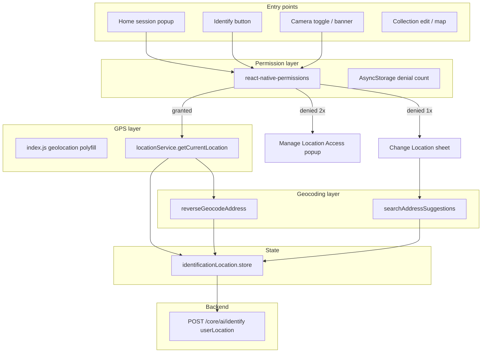

# Location Integration — Production Reference

This document describes how **Shroom AI** integrates device location: packages, native setup, permission popups, session orchestration, identification flow, geocoding, manual/custom location, and API usage.

It is written so another React Native app (or another Cursor session) can replicate the same architecture without reading the full codebase.

---

## Table of contents

1. [High-level architecture](#1-high-level-architecture)
2. [Packages and native setup](#2-packages-and-native-setup)
3. [Layer map (files and responsibilities)](#3-layer-map-files-and-responsibilities)
4. [Core services](#4-core-services)
5. [State management](#5-state-management)
6. [Permission denial tracking (manual handling)](#6-permission-denial-tracking-manual-handling)
7. [UI surfaces — all popups and sheets](#7-ui-surfaces--all-popups-and-sheets)
8. [Session-based home popup queue](#8-session-based-home-popup-queue)
9. [Identification flow (camera / gallery)](#9-identification-flow-camera--gallery)
10. [Geocoding and address resolution](#10-geocoding-and-address-resolution)
11. [Sending location to the backend](#11-sending-location-to-the-backend)
12. [Collection / details / edit screens](#12-collection--details--edit-screens)
13. [Remote Config knobs](#13-remote-config-knobs)
14. [Debugging](#14-debugging)
15. [Replication guide for another app (Cursor checklist)](#15-replication-guide-for-another-app-cursor-checklist)
16. [Decision matrix (quick reference)](#16-decision-matrix-quick-reference)

---

## 1. High-level architecture

Location is split into **four concerns**:

| Concern | What it does |
|--------|----------------|
| **Native permission** | Ask/check OS permission via `react-native-permissions` |
| **GPS read** | Read lat/lng via `@react-native-community/geolocation` (polyfilled as `navigator.geolocation`) |
| **Human-readable label** | Reverse geocode coords → city/region via geocode.maps.co (Nominatim) |
| **UX orchestration** | Popups, sheets, session queue, identification gate, manual fallback |



**Design principles used in this app:**

- **Never block identification forever** — user can always pick a custom location.
- **Dismiss UI before native dialog** — sheet/modal closes, then wait ~350–450ms, then call `requestLocationPermission()` (iOS requirement).
- **After 2 native denials** — stop showing the system prompt; show “Go to Settings” popup instead.
- **Optimistic UI** — show coordinate label immediately, resolve place name in background.
- **Session popups are queued** — subscription → notification → location → rate us (one at a time).

---

## 2. Packages and native setup

### NPM dependencies

| Package | Version (approx) | Role |
|---------|------------------|------|
| `@react-native-community/geolocation` | ^3.4.0 | `getCurrentPosition` / `watchPosition` |
| `react-native-permissions` | ^5.4.4 | Unified `check` / `request` / `openSettings` |

**Not used:** `expo-location`, `react-native-maps` (interactive maps forbidden for cost/security; static map images only).

### Geolocation polyfill (required for RN 0.81+)

React Native removed built-in `navigator.geolocation`. Polyfill in **`index.js`** before `AppRegistry`:

```js
import Geolocation from '@react-native-community/geolocation';

if (!global.navigator) {
  global.navigator = {};
}
if (!global.navigator.geolocation) {
  global.navigator.geolocation = Geolocation;
}
```

All GPS reads go through `src/utils/locationService.ts`, which calls `navigator.geolocation.getCurrentPosition`.

### Android — `AndroidManifest.xml`

```xml
<uses-permission android:name="android.permission.ACCESS_FINE_LOCATION" />
<uses-permission android:name="android.permission.ACCESS_COARSE_LOCATION" />
```

**Permission request strategy on Android:**

1. Request `ACCESS_FINE_LOCATION` first.
2. If not granted, request `ACCESS_COARSE_LOCATION`.
3. `checkLocationPermission` treats either fine or coarse as granted.

### iOS — `Info.plist`

```xml
<key>NSLocationWhenInUseUsageDescription</key>
<string>We use your location for location-based features and mushroom discovery.</string>
```

Only **When In Use** is requested (not Always).

### iOS — `Podfile` (`react-native-permissions` setup)

Must run **before** `use_native_modules`:

```ruby
require_relative '../node_modules/react-native-permissions/scripts/setup'
setup_permissions([
  'Camera',
  'PhotoLibrary',
  'Notifications',
  'LocationWhenInUse',
])
```

With `use_frameworks!`, RNPermissions is forced to static library so handlers link correctly (fixes “No permission handler detected”).

### Environment variables (geocoding)

In `.env.dev` / `.env.prod`:

```
GEOCODING_API_BASE_URL=https://geocode.maps.co
GEOCODING_API_KEY=<your-key>
```

Loaded via `src/constants/env.ts`. If key is missing, the app still works but falls back to coordinate strings only.

---

## 3. Layer map (files and responsibilities)

### Core utilities

| File | Responsibility |
|------|----------------|
| `index.js` | Geolocation polyfill |
| `src/utils/locationService.ts` | `getCurrentLocation`, `watchLocation`, `clearLocationWatch` |
| `src/utils/locationDebug.ts` | Dev-only `[LOCATION]` logging |
| `src/utils/geocodingApi.ts` | Reverse geocode, forward search, geocode address |
| `src/services/permissions/permission.service.ts` | `checkLocationPermission`, `requestLocationPermission`, `openDeviceSettings` |
| `src/services/permissions/locationPermissionAttempts.service.ts` | Denial count in AsyncStorage |

### State

| File | Responsibility |
|------|----------------|
| `src/features/camera/identificationLocation.store.ts` | Zustand: `{ location, permissionGranted }` for identify flow |
| `src/features/location/locationPopup.store.ts` | Zustand: `requestShow` flag for home session popup |

### Hooks / flow logic

| File | Responsibility |
|------|----------------|
| `src/features/camera/useIdentificationLocation.ts` | GPS fetch, permission request, address resolution, sheet-dismiss delay |
| `src/features/camera/useLocationToggleFlow.ts` | Popup/sheet state for camera toggle |
| `src/features/camera/locationToggle.helpers.ts` | Gate checks, API coord validation |
| `src/features/camera/resolveLocationAddress.ts` | Coord formatting, reverse geocode wrapper |

### UI components

| File | Responsibility |
|------|----------------|
| `src/molecules/Modal/LocationPermissionPopup.tsx` | Primary “Allow Location” centered modal |
| `src/molecules/Modal/LocationManageAccessPopup.tsx` | “Go to Settings” after 2 denials |
| `src/molecules/Modal/ChangeLocationBottomSheet.tsx` | Manual location search + confirm |
| `src/molecules/Modal/EnableLocationBottomSheet.tsx` | Deprecated wrapper → `LocationPermissionPopup` |
| `src/features/camera/components/IdentificationLocationBanner.tsx` | Camera/gallery location banner |
| `src/features/location/SessionLocationPermissionModal.tsx` | Home session popup controller |
| `src/features/camera/IdentificationEntryProvider.tsx` | Identify-from-home: location → camera permission chain |

### Orchestration

| File | Responsibility |
|------|----------------|
| `src/services/session/sessionModalOrchestrator.service.ts` | When to show location popup on home |
| `src/features/home/screens/HomeScreen.tsx` | Triggers session modal queue on focus |
| `src/navigation/RootNavigator.tsx` | Renders `SessionLocationPermissionModal`, chains to rate-us |

### API

| File | Responsibility |
|------|----------------|
| `src/features/camera/locationToggle.helpers.ts` | `getIdentificationUserLocationForApi()` |
| `src/services/api/features/core.api.ts` | Appends `userLocation` to identify multipart form |
| `src/features/camera/screens/DiagnosisLoadingScreen.tsx` | Reads store and passes coords to AI service |

---

## 4. Core services

### 4.1 `locationService.ts` — reading GPS

```ts
getCurrentLocation({
  enableHighAccuracy: true,  // default
  timeout: 15000,            // default
  maximumAge: 10000,         // default — accept cached position up to 10s
})
```

**Retry strategy** (in `useIdentificationLocation.fetchDeviceCoords`):

1. Try high accuracy, 8s timeout.
2. On failure → low accuracy, 10s timeout, `maximumAge: 120000` (2 min cache).

**Error codes** (from geolocation API):

| Code | Label |
|------|-------|
| 1 | PERMISSION_DENIED |
| 2 | POSITION_UNAVAILABLE |
| 3 | TIMEOUT |

`requestLocationPermission` inside `locationService.ts` is a **stub** — real permission calls live in `permission.service.ts`.

### 4.2 `permission.service.ts` — location permission

**iOS:** `PERMISSIONS.IOS.LOCATION_WHEN_IN_USE`

**Android:** checks both `ACCESS_FINE_LOCATION` and `ACCESS_COARSE_LOCATION`; requests fine first, then coarse.

**Return shape (`PermissionResult`):**

```ts
{
  granted: boolean;
  status: string;           // granted | denied | blocked | ...
  canRequestAgain: boolean;
  blocked: boolean;         // user must go to Settings
}
```

**Helpers:**

- `checkLocationPermission()` — read-only status
- `requestLocationPermission()` — show native dialog
- `openDeviceSettings()` — `react-native-permissions` `openSettings()` or `Linking.openSettings()`
- `ensurePermission('location')` — check → request → alert if blocked

---

## 5. State management

### Identification location store

```ts
type IdentificationLocation = {
  latitude: number;
  longitude: number;
  address: string;   // human label OR coord string while resolving
};

// Zustand store fields:
location: IdentificationLocation | null;
permissionGranted: boolean;
```

**Important:** `permissionGranted: true` is also set when user picks a **manual/custom** location (they opted in without GPS).

### Location popup store (home session only)

```ts
requestShow: boolean;
setRequestShow(show: boolean);
```

`HomeScreen` sets `requestShow: true` → `RootNavigator` shows `SessionLocationPermissionModal`.

---

## 6. Permission denial tracking (manual handling)

**File:** `src/services/permissions/locationPermissionAttempts.service.ts`

| Constant | Value | Meaning |
|----------|-------|---------|
| `MAX_LOCATION_DENIALS_BEFORE_SETTINGS` | `2` | After 2 native denials, show Settings popup |
| AsyncStorage key | `locationPermissionDenialCount` | Persisted denial count |

**Functions:**

- `getLocationPermissionDenialCount()`
- `incrementLocationPermissionDenialCount()` — call after native deny
- `resetLocationPermissionDenialCount()` — call when permission granted
- `shouldShowLocationManageSettingsPopup()` — `count >= 2`

### `requestLocationAccess()` decision tree

Used by identification flow (`useIdentificationLocation.ts`):

```
1. checkLocationPermission()
   └─ granted → refresh GPS, return { granted: true }

2. blocked OR denialCount >= 2
   └─ return { showManageSettingsPopup: true }

3. requestLocationPermission() [native dialog]
   └─ granted → reset denial count, refresh GPS, return { granted: true }
   └─ denied → increment denial count
       └─ blocked OR denialCount >= 2 → showManageSettingsPopup
       └─ else → showCustomLocationSheet
```

### Sheet dismiss before native prompt

**Problem:** Showing a React Native `Modal` and the iOS permission dialog at the same time breaks UX / can fail silently.

**Solution:** `runAfterSheetDismiss()` in `useIdentificationLocation.ts`:

```ts
const SHEET_DISMISS_DELAY_MS = Platform.OS === 'ios' ? 450 : 350;

InteractionManager.runAfterInteractions(() => {
  setTimeout(() => { /* requestLocationPermission() */ }, SHEET_DISMISS_DELAY_MS);
});
```

Always close `LocationPermissionPopup` first, then call `requestLocationAccessAfterSheetDismiss()`.

---

## 7. UI surfaces — all popups and sheets

### 7.1 `LocationPermissionPopup` (primary)

**When shown:**

- Home session flow (`SessionLocationPermissionModal`)
- Identify-from-home (`IdentificationEntryProvider`)
- Camera screen location toggle (`CameraScreen` via `useLocationToggleFlow`)

**Actions:**

| Button | Behavior |
|--------|----------|
| Allow Location | Close popup → delay → native permission → GPS or next popup |
| Custom Location | Close popup → open `ChangeLocationBottomSheet` |
| Close (X) / backdrop | Dismiss without granting |

**Copy:** `MODAL_STRINGS.bottomSheets.enableLocation`

### 7.2 `LocationManageAccessPopup` (settings fallback)

**When shown:** After 2 native denials or OS `blocked` status.

**Actions:**

| Button | Behavior |
|--------|----------|
| Go to Settings | `openDeviceSettings()` |
| Custom Location | Open manual location sheet |

**Copy:** `MODAL_STRINGS.bottomSheets.locationManageAccess`

### 7.3 `ChangeLocationBottomSheet` (manual location)

**When shown:**

- User taps “Custom Location” on any permission popup
- First denial in identification flow (automatic fallback)
- User taps location label on camera banner

**Behavior:**

- Debounced search (300ms, min 3 chars) via `searchAddressSuggestions`
- User picks suggestion OR types free text → `geocodeAddress` or address-only fallback
- On confirm → `applyManualLocation({ latitude, longitude, address })`
- If geocoding fails → stores `latitude: 0, longitude: 0` with text address (still usable for display; **not** sent to identify API)

**Copy:** `MODAL_STRINGS.bottomSheets.changeLocation`

### 7.4 `AppSheet` type `locationPermission` (legacy / settings preview)

**File:** `src/components/AppSheet/AppSheet.tsx` → `LocationPermissionContent`

Still used for some sheet-based permission previews. Dismisses sheet, waits 450ms, then requests permission. Prefer `LocationPermissionPopup` for new work.

### 7.5 `IdentificationLocationBanner`

On camera and gallery picker:

- **Permission off:** “Turn on location” + toggle
- **Permission on:** “Found at {place name}” (tappable → change location sheet)
- Shows “Detecting location…” while coords are resolving to a place name

### 7.6 `SessionLocationPermissionModal`

Thin controller wrapping `LocationPermissionPopup` + `LocationManageAccessPopup` for the **home session** path only. Does not open custom location sheet on first deny (user can tap Custom Location manually). On “Custom Location” → just closes (session popup is non-blocking).

---

## 8. Session-based home popup queue

### Queue order

```
subscription → notification → location → rate us → mushroom of the day
```

Only **one** modal runs per home focus (except chained dismissals).

### When location popup appears

**File:** `sessionModalOrchestrator.service.ts` → `shouldShowLocationModal()`

Conditions **all** required:

1. Location permission **not** already granted
2. Session count = **1**, or every **N** sessions after first: `(sessionCount - 1) % N === 0`
   - `N` = Remote Config `locationSessionInterval` (default **5**) → sessions 1, 6, 11, 16…
3. Not already shown this session (`LOCATION_SHOWN_FOR_SESSION_KEY`)

### Trigger path

```
HomeScreen useFocusEffect
  → incrementSessionCount()
  → getNextSessionModalInQueue(isPremium)
  → if next === 'location':
       markLocationShownForSession()
       setPendingRateUsAfterLocation(true)  // if rate us eligible
       setRequestShowLocationPopup(true)

RootNavigator useEffect
  → showSessionLocationPermission = true

User dismisses SessionLocationPermissionModal
  → continueAfterLocationPopup()
  → may show rate us next
```

### Chaining after notification

If notification popup shows first and location is also eligible:

```
setPendingLocationAfterNotification(true)
→ on notification dismiss → show SessionLocationPermissionModal
```

---

## 9. Identification flow (camera / gallery)

### 9.1 Entry from Home (recommended path)

**Provider:** `IdentificationEntryProvider` (wraps app in navigation tree)

```
User taps Identify
  → startIdentificationEntry()
  → shouldShowIdentificationLocationGate()?
       true  → LocationPermissionPopup
       false → check camera permission → CameraMain
```

**Gate condition** (`shouldShowIdentificationLocationGate`):

- `permissionGranted === false` AND
- no meaningful location set (no address, or fallback placeholder only)

### 9.2 On camera screen

**Hook:** `useLocationToggleFlow` + `useIdentificationLocation`

- Location banner at top
- Toggle on → if no permission → `LocationPermissionPopup`
- After grant → `refreshFromDevice()` (GPS + reverse geocode)
- Tap place name → `ChangeLocationBottomSheet`

### 9.3 Before identify API call

**File:** `DiagnosisLoadingScreen.tsx`

```ts
const userLocation = getIdentificationUserLocationForApi();
// → [lat, lng] | undefined
```

**Included in API only when:**

- `permissionGranted === true`
- Valid finite lat/lng
- **Not** `0, 0` (manual text-only fallback)

### 9.4 Address resolution pipeline

```
GPS coords received
  → setLocation({ lat, lng, address: "12.3456, 78.9012" })  // immediate
  → background: reverseGeocodeAddress(lat, lng)
  → setLocation({ lat, lng, address: "Portland, Oregon" })    // update UI
```

If reverse geocode fails → keep coordinate label.

---

## 10. Geocoding and address resolution

**Provider:** [geocode.maps.co](https://geocode.maps.co) (Nominatim / OpenStreetMap)

**File:** `src/utils/geocodingApi.ts`

| Function | Use case |
|----------|----------|
| `reverseGeocodeAddress(lat, lng)` | GPS → short label (“City, Region”) |
| `searchAddressSuggestions(query)` | Change Location autocomplete (limit 5) |
| `geocodeAddress(query)` | Forward geocode typed address |

**Label formatting** (`formatGeocodingLabel`): prefers `city, region` → `city, country` → first parts of `display_name`.

**Rate limits:** HTTP 429/503 throws; caller catches and degrades gracefully.

**No API key:** functions return empty / skip; app uses raw coordinates.

---

## 11. Sending location to the backend

### Identify API

**Endpoint:** `POST /core/ai/identify` (multipart)

**Field:** `userLocation` — JSON stringified array `[latitude, longitude]`

```ts
// core.api.ts
if (options?.userLocation?.length === 2) {
  formData.append('userLocation', JSON.stringify(options.userLocation));
}
```

**When omitted:** user declined location and has no valid GPS/manual coords.

### Maps (display only)

- **Static maps:** `src/utils/staticMapApi.ts` + `StaticMap` component (Google Static Maps API URL builder)
- **Not** interactive `MapView`

---

## 12. Collection / details / edit screens

| Component | Location behavior |
|-----------|-------------------|
| `MapPreview` | Checks permission; fetches user location for map marker overlay |
| `CustomLocationInput` | Editable address + static map; “use my location” button |
| `MushroomDetailsScrollSections` | `checkLocationPermission` for map section |
| `EditMushroomDetailsScreen` | Uses `CustomLocationInput` for saved specimen location |

These reuse `permission.service` + `locationService` but **do not** use the identification Zustand store.

---

## 13. Remote Config knobs

| Key | Default | Effect |
|-----|---------|--------|
| `locationSessionInterval` | `5` | Show home location popup on session 1, then every 5 sessions (6, 11, 16…) |

Defined in `remoteConfig.service.ts` and `remoteconfig.template.json`.

---

## 14. Debugging

### Dev logs

Filter Metro console: **`[LOCATION]`**

Logged steps: permission checks, GPS start/success/fail, geocode requests, watch updates.

### Common issues

| Symptom | Likely cause | Fix |
|---------|--------------|-----|
| `navigator.geolocation missing` | Polyfill not in `index.js` | Add polyfill block |
| iOS “No permission handler detected” | Podfile `setup_permissions` missing or RNPermissions not static | Fix Podfile per section 2 |
| Native dialog never appears | Modal still open | Use `runAfterSheetDismiss` |
| Always “Manage Location Access” | Denial count ≥ 2 in AsyncStorage | Clear `locationPermissionDenialCount` key or grant in Settings |
| Place name stays as coords | `GEOCODING_API_KEY` missing | Set env var |
| `userLocation` not in API | `0,0` coords or `permissionGranted: false` | Check `getIdentificationUserLocationForApi()` |

---

## 15. Replication guide for another app (Cursor checklist)

Use this as a **Cursor prompt** or implementation checklist when porting to a new React Native app.

### Phase A — Native foundation

```text
[ ] Install @react-native-community/geolocation and react-native-permissions
[ ] Add geolocation polyfill to index.js (navigator.geolocation)
[ ] AndroidManifest: ACCESS_FINE_LOCATION + ACCESS_COARSE_LOCATION
[ ] iOS Info.plist: NSLocationWhenInUseUsageDescription
[ ] iOS Podfile: setup_permissions(['LocationWhenInUse'])
[ ] pod install && rebuild native apps
```

### Phase B — Service layer

```text
[ ] Create permission.service.ts with checkLocationPermission / requestLocationPermission
      - Android: fine first, then coarse
      - Return { granted, blocked, canRequestAgain, status }
[ ] Create locationService.ts wrapping getCurrentPosition
      - high accuracy retry → low accuracy fallback
[ ] Create locationPermissionAttempts.service.ts
      - AsyncStorage denial count, threshold = 2
[ ] Create locationDebug.ts for __DEV__ logging
```

### Phase C — State + hooks

```text
[ ] Zustand store: { location: {lat,lng,address}, permissionGranted }
[ ] useIdentificationLocation hook:
      - refreshFromDevice()
      - requestLocationAccess() with denial branching
      - runAfterSheetDismiss() before native prompt
      - applyManualLocation()
[ ] locationToggle.helpers.ts:
      - hasIdentificationLocationSet()
      - getIdentificationUserLocationForApi()
      - shouldShowIdentificationLocationGate()
```

### Phase D — UI components

```text
[ ] LocationPermissionPopup — Allow / Custom / Close
[ ] LocationManageAccessPopup — Settings / Custom (after 2 denials)
[ ] ChangeLocationBottomSheet — search + geocode + confirm
[ ] IdentificationLocationBanner — toggle + place name
[ ] SessionLocationPermissionModal — home session wrapper
[ ] IdentificationEntryProvider — location → camera permission chain
```

### Phase E — Geocoding (optional but recommended)

```text
[ ] geocodingApi.ts with reverse + search + forward
[ ] Env: GEOCODING_API_BASE_URL, GEOCODING_API_KEY
[ ] resolveLocationAddress.ts — coords first, name in background
```

### Phase F — Orchestration (if you want home popup)

```text
[ ] locationPopup.store.ts — requestShow flag
[ ] sessionModalOrchestrator — shouldShowLocationModal + queue
[ ] HomeScreen — getNextSessionModalInQueue on focus
[ ] RootNavigator — SessionLocationPermissionModal + dismiss chain
```

### Phase G — API integration

```text
[ ] getIdentificationUserLocationForApi() before API call
[ ] Append userLocation JSON array to multipart identify request
[ ] Skip when lat/lng are 0,0 or permission not granted
```

### Phase H — QA scenarios

```text
[ ] Fresh install → Allow → GPS label appears → identify sends coords
[ ] Deny once → Custom Location sheet opens
[ ] Deny twice → Manage Location Access → Settings deep link
[ ] Custom text only (no geocode) → display works, API omits userLocation
[ ] Return from Settings with permission on → AppState sync refreshes GPS
[ ] Home session popup on session 1, not again until session 6 (if interval=5)
[ ] Modal closed before native dialog on iOS (no overlap)
```

### Minimal Cursor prompt (copy-paste)

```text
Implement React Native location integration matching this architecture:

1. Packages: @react-native-community/geolocation + react-native-permissions
2. Polyfill navigator.geolocation in index.js
3. permission.service: check/request location (Android fine→coarse)
4. locationService: getCurrentLocation with high→low accuracy retry
5. AsyncStorage denial count; after 2 denials show Settings popup not native dialog
6. Close Modal/Sheet, wait 450ms (iOS) / 350ms (Android), then request permission
7. Zustand store for {location, permissionGranted}
8. Three UI surfaces: LocationPermissionPopup, LocationManageAccessPopup, ChangeLocationBottomSheet
9. Reverse geocode via geocode.maps.co; show coords immediately, place name in background
10. API: send userLocation as JSON [lat,lng] only when permission granted and coords valid (not 0,0)
11. Optional: session-based home popup queued after notification, Remote Config interval

Follow the full spec in docs/LOCATION_INTEGRATION.md
```

---

## 16. Decision matrix (quick reference)

| User action | System response |
|-------------|-----------------|
| Tap Allow Location (1st time) | Close UI → native dialog → GPS → reverse geocode |
| Tap Allow Location (2nd+ deny history) | Show Manage Location Access popup |
| Native deny (1st time) | Increment count; offer Custom Location sheet (identify flow) |
| Native deny (2nd time) | Show Manage Location Access popup |
| Tap Custom Location | Open Change Location search sheet |
| Pick manual place with coords | `permissionGranted=true`, store lat/lng/address |
| Type address, geocode fails | Store address + `0,0`; display only, no API coords |
| Toggle location on camera | Same as Allow Location path |
| Home session popup dismiss | Continue queue (rate us if pending) |
| App returns from Settings | `AppState` listener → `syncPermission()` → refresh GPS if granted |

---

## Related files (quick index)

```
index.js
android/app/src/main/AndroidManifest.xml
ios/Birdzy/Info.plist
ios/Podfile
src/constants/env.ts
src/utils/locationService.ts
src/utils/geocodingApi.ts
src/utils/locationDebug.ts
src/services/permissions/permission.service.ts
src/services/permissions/locationPermissionAttempts.service.ts
src/services/session/sessionModalOrchestrator.service.ts
src/features/location/locationPopup.store.ts
src/features/location/SessionLocationPermissionModal.tsx
src/features/camera/identificationLocation.store.ts
src/features/camera/useIdentificationLocation.ts
src/features/camera/useLocationToggleFlow.ts
src/features/camera/locationToggle.helpers.ts
src/features/camera/IdentificationEntryProvider.tsx
src/features/camera/components/IdentificationLocationBanner.tsx
src/molecules/Modal/LocationPermissionPopup.tsx
src/molecules/Modal/LocationManageAccessPopup.tsx
src/molecules/Modal/ChangeLocationBottomSheet.tsx
src/features/home/screens/HomeScreen.tsx
src/navigation/RootNavigator.tsx
src/config/strings/modals.strings.ts
```

---

*Last updated from Shroom AI codebase audit. Adapt product copy, Remote Config keys, and API field names when porting to another app.*
